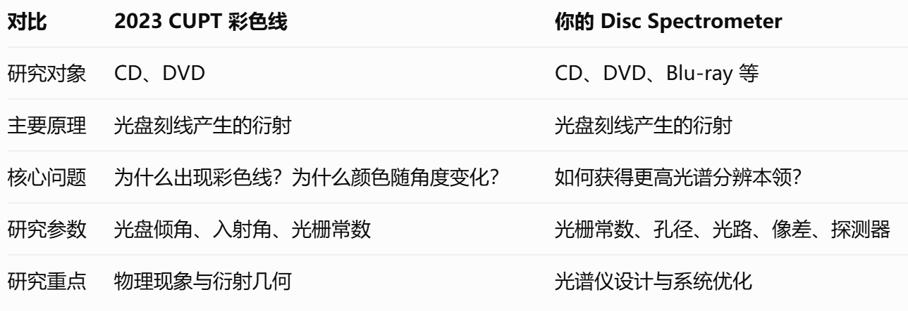
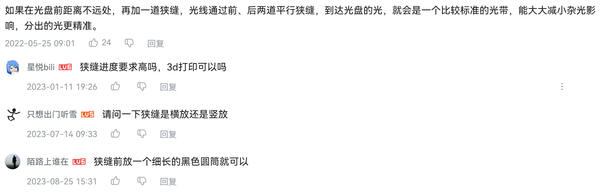

# IYPT 2027 第 2 题：光盘光谱仪资料库

更新：2026-10-12。目标是先按公开设计复刻出能拍摄、标定的样机，再比较分辨率、通光量与像差。“反射”与“透射”分开标注。

赛题原文及 可见 [GYPT 2027 第 2 题页面](https://www.gypt.org/aufgaben/02-disc-spectrometer.html)：它特别提示比较光盘表面、入射/观察角及不同盘片。这里的赛题措辞明确是**反射衍射光栅**。

## 很类似的赛题 : 23年CUPT 第四题：彩色线
原题：
When a compact disc or DVD is illuminated with light coming from a filament lamp in such a way that only rays with large angles of incidence are selected, a clear green line can be observed. The colour varies upon slightly changing the angle of the disc. Explain and investigate this phenomenon.

中文翻译：
当白炽灯发出的光以较大的入射角照射 CD 或 DVD 光盘时，可以观察到一条清晰的绿色亮线。稍微改变光盘的倾斜角度，亮线的颜色也会改变。解释并研究这一现象

## 实操: 最适合复刻的五套

| 路线 | 原资料 | 能照着做什么 | 与赛题的关系 |
| --- | --- | --- | --- |
| A. CD 纸盒目视仪 | [朱进等：用光盘自制光谱仪（中文）](https://www.cs.cmu.edu/~zhuxj/astro/cn/html/spectrometer.html) | 纸盒、CD、约 0.2 mm 狭缝；作者给出约 60° 的 CD 摆放、光路图和不同光源照片，也比较了 CD-R 与普通 CD。 | **反射式**，最快做第一台；文中提醒该角度不能直接套到 DVD。 |
| B. DVD 高分辨率纸板仪 | [Wakabayashi 与 Hamada，2006，论文及纸样 PDF](https://sage.nasa.gov/wp/wp-content/uploads/2016/08/Instructions_build_a_spectroscope.pdf)；[期刊 DOI](https://doi.org/10.1021/ed083p56) | 有毫米尺寸的结构图和展开图；DVD 约 60°，推荐狭缝约 0.5 mm、遮光掩模。论文报告可分开 Hg 577/579 nm 双线。 | **反射式**，建议作为第一个可量化的“按图复刻”目标；这项分辨结果须在自己的光源、相机条件下重测。 |
| C. MIT CD 课程样机 | [MIT OCW 实验幻灯片 PDF](https://ocw.mit.edu/courses/6-s079-nanomaker-spring-2013/fd5fb21a4ac9d9d009cab56a655d933e_MIT6_S079S13_lab_slides01.pdf)；[课程视频目录](https://ocw.mit.edu/courses/6-s079-nanomaker-spring-2013/resources/videos/) | 面向本科生的 CD 光谱仪课程资料和制作演示，可对照器件布置与拍摄流程。 | **CD 路线**，适合作第二个装配参考。 |
| D. 纸筒 CD/DVD＋摄像头 | [BUAP 项目网页](https://ciiec.buap.mx/Make-your-Own-Spectroscope/)；[源码、模板和校准程序](https://github.com/lvillasen/Make-your-Own-Spectroscope/) | 网页展示计算和纸筒制作，仓库含模板 PDF、网页程序、摄像头采集与简单波长校准。 | **反射式**；网页讲了狭缝与盘轨道方向，适合从目视过渡到可记录数据。 |
| E. Public Lab 视频光谱仪 | [完整制作说明](https://publiclab.org/wiki/video-spectrometer-construction)；[折纸版 PDF](https://publiclab.org/sites/default/files/8.5x11mini-spec3.8.pdf)；[Spectral Workbench 源码](https://github.com/publiclab/spectral-workbench) | VHS 盒、黑卡狭缝、DVD-R 分层后的透明片、USB 摄像头；说明详细解释对焦、调角、遮杂散光和软件校准。 | **透射式 DVD**，硬件/软件经验有价值，但不能直接充当赛题的反射式主方案。 |

## 更多实际制作资料

### B站视频
【做一个CUPT2027要求的的光盘光谱仪？一个视频帮你搞定。】 https://www.bilibili.com/video/BV1Mb3C6YEEU/?share_source=copy_web&vd_source=434998b0acfb7eca4042d8cf47ca0604

> COMSOL仿真
【CUPT2027.02【光盘光谱仪】Disc spectrometer的仿真分享与理论思路探究】 https://www.bilibili.com/video/BV1fdbi6rEhV/?share_source=copy_web&vd_source=434998b0acfb7eca4042d8cf47ca0604

>完整圆环--可作为非常简易的参考!!
【【我居然拿光盘做了这种事！】物理实验-光盘的衍射实验】 https://www.bilibili.com/video/BV17J411H78c/?share_source=copy_web&vd_source=434998b0acfb7eca4042d8cf47ca0604

>完整圆环--效果看起来不差!! 
【【科普动画】光盘衍射呈现彩虹即反射光栅原理可视化动画 | 2025中国好创意交叉学科赛道省赛二等奖】 https://www.bilibili.com/video/BV1FZhCzHEPs/?share_source=copy_web&vd_source=434998b0acfb7eca4042d8cf47ca0604
(**这个可以作为PPT封面**)【白光穿过光盘：圆光栅衍射竟“画”出彩色圈】 https://www.bilibili.com/video/BV1tz9hBvED4/?share_source=copy_web&vd_source=434998b0acfb7eca4042d8cf47ca0604

>关于准直光路的设计:还有高手

>喵的我还用刀去一点点撬开CD-R的印刷层,原来直接用胶带撕开就行...这个将disc撕掉反射层后来用的, 也是透射光栅
【一个视频教你做光盘光谱仪CUPT/IYPT2027Disc spectrometer】 https://www.bilibili.com/video/BV1Ba3W6ZEav/?share_source=copy_web&vd_source=434998b0acfb7eca4042d8cf47ca0604

>电机带动光盘旋转(有点好玩).如果光束在光盘上形成的光斑是切向的,此时会观察到一个角度很小的彩虹扇形, 通过旋转,把圆心角扩大成360度从而便于观察
【绚烂的光栅衍射现象，用灯光照射旋转的光盘，有趣的事情发生了】 https://www.bilibili.com/video/BV1F44y177DC/?share_source=copy_web&vd_source=434998b0acfb7eca4042d8cf47ca0604

## 理论部分

- [Newport/MKS《Diffraction Grating Handbook》](https://www.newport.com/mam/celum/celum_assets/np/resources/MKS_Diffraction_Grating_Handbook.pdf?0=)：光栅方程、衍射级次、理论分辨本领、槽距误差和波前质量；可作为推导与设计依据。
- [HORIBA：Bandpass and Resolution](https://www.horiba.com/int/bandpass-resolution/) 与 [Order, Resolution, and Dispersion](https://www.horiba.com/pol/scientific/technologies/spectrometers-and-monochromators/order-resolution-and-dispersion/)：区分光栅理论分辨率与整机谱线 FWHM，解释狭缝成像、像差、色散和像素的影响。
- 光谱仪器原理教材
- >并非高中物理----【【高中物理】还在为搞不懂“光栅”发愁嘛？一个视频带你看透光栅衍射背后的物理本质，直观感受波动光学之美~】 https://www.bilibili.com/video/BV1DSC9YnEEH/?share_source=copy_web&vd_source=434998b0acfb7eca4042d8cf47ca0604

### 反射式光盘设计

1. [Science in School/CERN：A fresh look at light](https://scienceinschool.web.cern.ch/article/2007/spectrometer/)：CD＋纸盒＋狭缝，包含拍摄方法和光源观察；适合与 A 路线交叉核对。
2. [NASA JPL：Using Light to Study Planets](https://www.jpl.nasa.gov/edu/resources/lesson-plan/using-light-to-study-planets/)：半片 CD、麦片盒、遮光胶带和多种光源的教学活动；适合快速制作和记录观察表。
3. [NASA Sun as a Star 活动 PDF](https://science.nasa.gov/wp-content/uploads/2023/09/Sun_as_a_Star-_Afterschool_Learning_Activities.pdf)：包含 CD 扇形片的纸样和纸筒版本，便于批量做不同结构的对照样机。
4. [NASA：Analyzing Spectra 学生活动](https://nasaeclips.arc.nasa.gov/resources/download/77)：CD/DVD、约 25 cm 纸筒等材料的教学制作步骤。
5. [Wakabayashi，2008：潜望镜式 DVD 光谱仪](https://doi.org/10.1021/ed085p849)；[论文 PDF](https://sciencemadness.org/scipics/spectroscope_2008.pdf)：在 DVD 与入射狭缝间加小平面镜以便正面观察与拍照；作者报告用双刀片狭缝分开 Na D 589.0/589.6 nm。可作为 B 路线之后的改进复刻。
6. [BUAP：Make your own spectroscope](https://ciiec.buap.mx/Make-your-Own-Spectroscope/)：纸筒式 CD/DVD 反射光路、狭缝与轨道方向、相机记录；与上述源码仓库配套。
7. [ETH Zürich：Do-it-yourself Spectrometer PDF](https://ap.phys.ethz.ch/RemoteExperiments/DIYSpectrometer_en.pdf)：CD 纸盒仪的教学说明；适合核对加工细节及实验步骤。
8. [Avanza STEM：Build a Spectroscope from a CD](https://www.avanzastem.org/projects/cd-spectroscope)：逐步制作，特别提及用直边形成较规整的狭缝；作为入门补充。

### 摄像头、软件和透射式旁证

9. [Theremino Spectrometer 总入口](https://www.theremino.com/en/downloads/automation#spectrometer)：原项目的程序、带源码版本、中文/英文的帮助、光栅、光源、WebCam 制作、线阵传感器制作等文档。下载软件应从这一原站入口进入。
10. [Theremino Technology 中文 PDF（题目所给）](https://www.theremino.com/wp-content/uploads/files/Theremino_Spectrometer_Technology_CHN.pdf)：讨论光盘光栅、光路和技术取舍。**先辨别文中反射/透射模式及光盘分层处理，不能把不同光路的尺寸混用。**
11. [Theremino WebCam 制作手册（英文）](https://www.theremino.com/wp-content/uploads/files/Theremino_Spectrometer_Construction_WebCam_ENG.pdf)：相机、光栅、调焦和标定的完整手册；总入口另有中文版本。
12. [Theremino 软件帮助（英文）](https://www.theremino.com/wp-content/uploads/files/Theremino_Spectrometer_Help_ENG.pdf)：采集、校准、背景扣除、多点校准等操作。
13. [PhysicsOpenLab：Webcam diffraction grating spectrometer](https://physicsopenlab.org/2015/11/26/webcam-diffraction-grating-spectrometer/)：另一团队使用 Theremino 软件的实际搭建及测试，可参考光路、灯谱与太阳谱。
14. [Public Lab 视频光谱仪制作指南](https://publiclab.org/wiki/video-spectrometer-construction)：透射 DVD＋USB 相机的逐步照片；狭缝 <1 mm、相机重调焦至约 20 cm、遮光等经验可迁移。
15. [Public Lab DIY 套件说明 PDF](https://publiclab.org/sites/default/files/PLOTS%20DIY%20Spectrometer%20Guide%20v1.0.pdf) 与 [Spectral Workbench](https://github.com/publiclab/spectral-workbench)：硬件配套的采集、谱图分享与分析路线。
16. [lvillasen 开源 CD/DVD 项目](https://github.com/lvillasen/Make-your-Own-Spectroscope/)：模板 `templete_4.65_diammeter_11.3_length.pdf`、`index.html` 与 JavaScript 可直接检视/运行。
17. [回收 DVD＋ESP32-CAM 项目](https://github.com/bogdanbora-source/A-low-cost-transmission-grating-spectrometer-using-a-recycled-DVD-and-an-ESP32-CAM)：作者给出 0.10 mm 双刀片狭缝、250 mm 无准直透镜管、代码与汞灯标定方法，并报告 0.82 nm FWHM。
18. [Meg4Byte：DIY Spectrometer](https://github.com/Meg4Byte/DIY-Spectrometer)：光盘、USB 摄像头和 Theremino 的公开制作记录；作为不同布置的案例，优先按原站手册核对尺寸和校准。
19. [Digital-Spectroscope](https://github.com/joshbrew/Digital-Spectroscope)：3D 打印结构与网页采集工具；

## 可直接用于设计比较的论文

| 文献 | 具体可学到什么 | 资料状态 |
| --- | --- | --- |
| [Wakabayashi & Hamada，2006，*A DVD Spectroscope*](https://sage.nasa.gov/wp/wp-content/uploads/2016/08/Instructions_build_a_spectroscope.pdf) | 完整 DVD 反射式尺寸、遮光掩模、材料选择及 Hg 双线验证；论文指出双层 DVD 不适用，DVD-RAM 可能因轨距不同而表现不一。 | 开放全文及图纸。 |
| [Wakabayashi，2008，*Periscope-Type DVD Spectroscope*](https://sciencemadness.org/scipics/spectroscope_2008.pdf) | 反射式 DVD＋小镜改造、相机数字化、Na D 双线与吸收谱。 | 可读论文 PDF；纸样补充材料的可得性需再查。 |
| [Trindade 等，2014，*Low-Cost Spectro-graph Based on a WebCam*](https://researchportal.ulisboa.pt/en/publications/low-cost-spectro-graph-based-on-a-webcam-a-student-project/)；[DOI](https://doi.org/10.7227/IJEEE.51.1.1) | 明确比较 CD/DVD/Blu-ray，装了可转动的介质支架，最后按实际相机位置选择 DVD；与商用光谱仪比较 LED 谱。特别适合设计介质比较实验。 | 大学元数据与摘要可访问；具体结构和数据需查论文全文。网上转载表格中的 Blu-ray 线密度有疑似数量级笔误，见下节。 |
| [Wakabayashi 等，1998，*CD-ROM Spectroscope: A Simple and Inexpensive Tool for Classroom Demonstrations on Chemical Spectroscopy*](https://doi.org/10.1021/ed075p1569) | 2006 DVD 论文引用的早期 CD 先例，可追溯原始反射式结构。 | DOI 索引；全文可得性待查。 |
| [Developing a Cost-Effective Spectrometer，2025](https://arxiv.org/abs/2510.06703) | DVD＋摄像头＋Python，拿商用设备比对标定结果；参考其验证框架。 | 预印本摘要可访问；核对其光路后再用于结构复刻。 |
| [Riihiaho 等，2021，*A Do-It-Yourself Hyperspectral Imager Brought to Practice with Open-Source Python*](https://pmc.ncbi.nlm.nih.gov/articles/PMC7915091/)；[DOI](https://doi.org/10.3390/s21041072) | 可复刻的推扫式高光谱成像系统：狭缝一次取得一条空间线，传感器另一方向记录波长；移动样品并堆叠各帧，得到两个空间维度加一个光谱维度的图像立方体。文章重点是狭缝倾斜与光谱线弯曲（spectral smile）的软件校正，附[开源代码](https://github.com/silmae/desmiler)与[外壳模型/数据](https://osf.io/3uhkb)。 | 开放全文；原装置用 **600 线/mm 透射光栅**，不是光盘反射式结构。适合参考成像、扫描和像差评价方法，不能直接作为赛题主样机。 |
| [On the Instrument Profile of Slit Spectrographs](https://arxiv.org/abs/1409.0137) | 分析狭缝、光栅和像素共同决定的仪器线形；用来避免把理论 `mN` 当实际分辨率。 | 开放预印本；偏理论，不是光盘制作教程。 |

