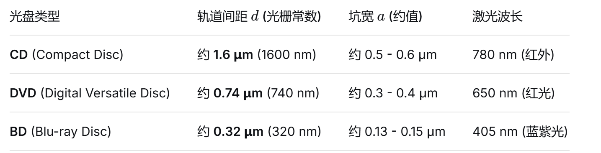

## Q光盘的细纹是环向的, 那么如果是一个线光源打上去,条纹是环状的?
A:轨道是环向的，但狭缝加准直只照亮一小段弧，弧内轨道近似平行直线，衍射在垂直于轨道的方向上，谱带仍是直的。照亮很大一片时各处轨道方向不同，衍射光才铺成弧形——这是掩模要遮掉的区域，也是谱线弯曲像差的来源。

## Q光盘这么多光栅常数的型号,每种型号的反射率又有很多种,如果我剥离反射层和光栅层呢?是不是就无所谓了?

A:完全剥离，那么不论是 ROM、-R 还是 -RE，如果您把反射层透明的塑料基板（光栅层）它们的区别确实就变得微乎其微了，但这时您制作的就不再是“反射光栅”，而是“透射光栅”（Transmission Grating）。
当您把金属反射层彻底去掉后，光线会直接穿透光盘，您需要让光线从光盘后面穿过去，在另一侧观察衍射出来的彩虹光谱。
在这个情况下，挑选碟片时需要注意以下两点微小的差异：

#### 1. 结构与凹坑品质（仍有极微小影响）

• ：工厂直接用母盘在透明塑料上“压印”出极为精准、边缘锐利的微型凹坑（Pits）。去掉反射层后，它的透明基板结构最完整，ROM（最完美） 透射出来的光谱条纹最清晰、杂散光最少 。
• -R / -RE（次之）：它们的轨道槽（Grooves）内含有有机染料或相变化金属。在剥离反射层时，这些染料往往会残留在透明塑料的轨道里。如果没有用酒精彻底清洗干净，残留的染料会吸收光线或导致光线散射，使彩虹变暗或模糊。

#### 2. 不同世代光盘的“剥离难易度”完全不同（关键）

如果您打算剥离反射层， 光盘的世代（CD vs DVD vs BD） 决定了您的制作难度，这比 ROM 或 -R 的区别重要得多：
• DVD（最容易成功）👍：
DVD 就像三明治，结构是两层 0.6mm 的塑料片夹着中间的金属反射层。您只要用美工刀从边缘轻轻一挑，就能轻易把 DVD 对半撕开 。撕开后，一边是带有金属的废片，另一边就是完美的、带有光栅结构的纯透明基板，连洗都不用洗。
•CD ：
CD 的结构是把反射层和保护漆直接涂在 1.2mm 的透明基板“背面”。如果您用胶带把金属层粘下来，很容易连带把微小的轨道结构一起破坏掉，而且背面的保护漆极难清除干净。CD（极度困难）👎
• BD：
蓝光的数据轨道距离表面只有 0.1mm，它的保护层（Cover Layer）非常薄且黏得极紧。要剥离蓝光的反射层，通常需要使用强力胶带（如 3M 布胶带）反复黏起，或者使用特定溶剂，操作不当很容易直接把微细的光栅轨道刮伤。蓝光 BD（需要技巧）⚠️

#### 🛠️ 最佳实践建议

如果您想制作透射光栅 （剥离反射层）：
建议直接找一张废弃的 DVD-ROM（如旧电影光盘）或空白 DVD-R。用刀片从边缘挑开、将它对半撕开 ，取用那层透明的、没有印刷面的塑料片。这是目前公认成功率最高、效果最好且最省力的 DIY 方案！

### Q实验室分光计用的是望远镜加转台,那么相当于光栅到物面的距离越大，它就分离的越充分，分辨率就越高？
A 然而每个衍射峰有宽度,距离变大的同时, 也增大了宽度

### Q是不是光束在光盘上离圆心的位置也有影响，因为越往外，它的曲率半径越大，就不能看作是平行光栅？(就想象一个细长的长方形去截条纹螺线，长方形的长边沿着半径向外移动)
A 确实

### Q在望远镜分光计载物台上放cd光盘，将准直平行光管的狭缝调整至竖直，然后放上cd光盘碎片，保证纹路方向和狭缝近似平行，然后发现的确分光了，但是比较模糊，可能什么原因
A: https://chatgpt.com/share/6ad0e1bb-e950-83ee-b18a-08e91d10d66a

### Q光盘结构? 在这个实验中我们需要关心什么
https://www2.nsysu.edu.tw/physdemo/2012/C3/100%E6%BC%94%E7%A4%BA%E7%9C%8B%E6%9D%BF.pdf

我们需要关心的是: 根据光学书(p224)上的"周期性多缝结构的光栅衍射",想得到衍射强度的角度分布,我们需要知道缝宽和周期
>对应到光盘上, 缝宽就是轨道上信息坑pit的宽度,而周期就是光盘的轨道间距,也就是衍射光栅常数

另外,我们需要知道,光盘并不能等价于平行光栅,因为除了由内往外导致的曲率半径不一样之外,还有一点是光盘的坑呈螺线而非同心圆

### 书上说刻蚀深度会影响颜色效率. 那么光盘的刻蚀深度是多少?
A 为了让读取激光在“坑点（Pit）”与“平面（Land）”之间反射时产生最大的相消干涉（将信号识别为 0 或 1），最佳的刻蚀深度通常设计为激光在光盘塑料基材中波长的 1/4

#### Q理论简化对结果有什么影响呢
1. 划线反射光栅(平行)
2. 同心圆划线反射光栅
3. 螺线反射光栅